<div align="center">


**Roguelite de ação isométrica para navegador. Doce ou travessura: todo trato tem um preço.**

[](https://emanuelcandido.itch.io/porta-a-porta)


</div>

---

## Sobre o jogo

Na noite de Halloween, o **Dono do Bairro**, uma casa antiga de três andares, comprou cada morador com
tratos. Só uma criança que bate de porta em porta consegue juntar poder suficiente para enfrentá-lo,
pagando o mesmo preço que todos pagaram.

Você escolhe uma fantasia (Bruxinha, Fantasma, Esqueleto ou Vampirinho) e luta pelas ruas com
habilidades **Q, W, E e R**, no estilo de combate dos MOBAs, só que sozinho. Entre uma rua e outra,
bate nas portas e aceita **tratos**: poderes fortes que deixam o bairro pior para sempre naquela run.
Postes se apagam, ruas escurecem e casas passam a te perseguir.

O jogo foi feito para a [Gamejam Halloween Carol Carvalho](https://itch.io/jam/halloween-carol-carvalho)
e está publicado no [itch.io](https://emanuelcandido.itch.io/porta-a-porta), com versão para navegador
e downloads para Windows e Linux.

<div align="center">
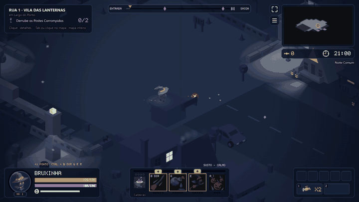

<sub>Trecho de gameplay gravado do build de produção. <a href="docs/media/gameplay.webm">Vídeo em melhor qualidade (WebM)</a>.</sub>
</div>

### Pilares do design

- **Luta de MOBA, sozinho.** Habilidades miradas, recargas, mana, ultimate e posicionamento. Acertar e
  desviar é a habilidade principal.
- **Poder sempre tem preço.** Os melhores itens são tratos com maldição, e a maldição muda o mapa.
- **O bairro conta a sua run.** Basta olhar a rua para ver os tratos que você aceitou.
- **Luz é terreno.** A luz dos postes e das janelas define quem te vê, onde você se cura e onde a
  sombra caça.

## Capturas

|                                                                              |                                                                             |
| :--------------------------------------------------------------------------: | :-------------------------------------------------------------------------: |
|         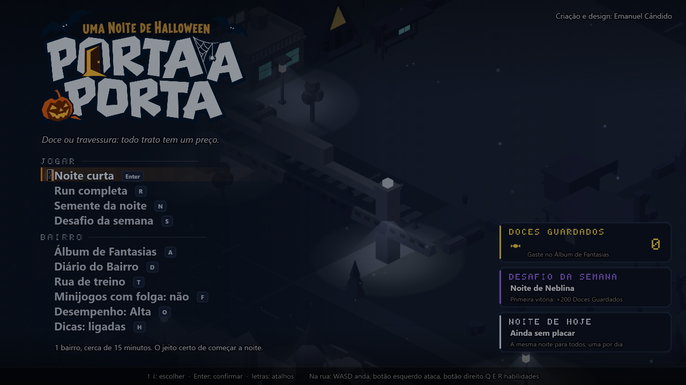          |     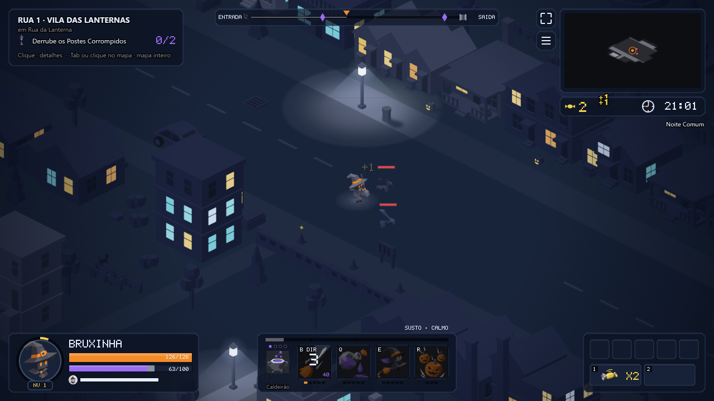     |
|                        Tela de título e modos de jogo                        |                      Primeira rua: Vila das Lanternas                       |
|     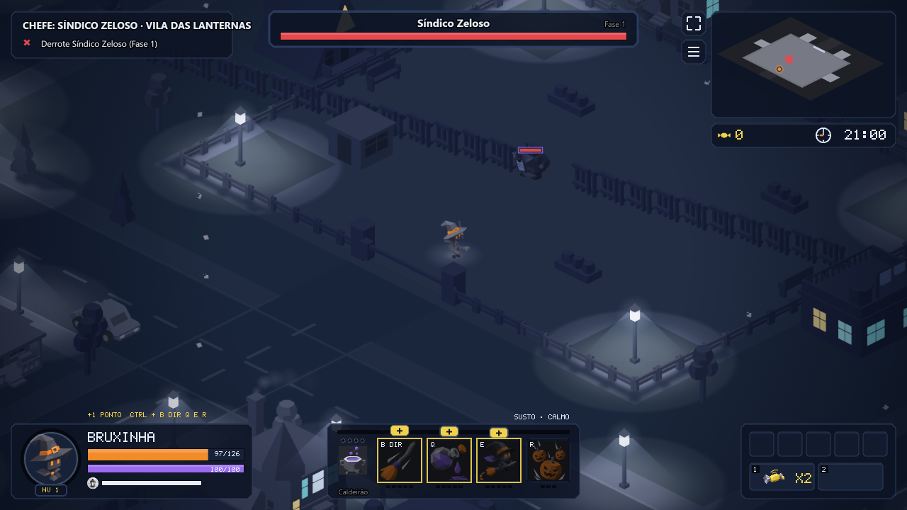      | 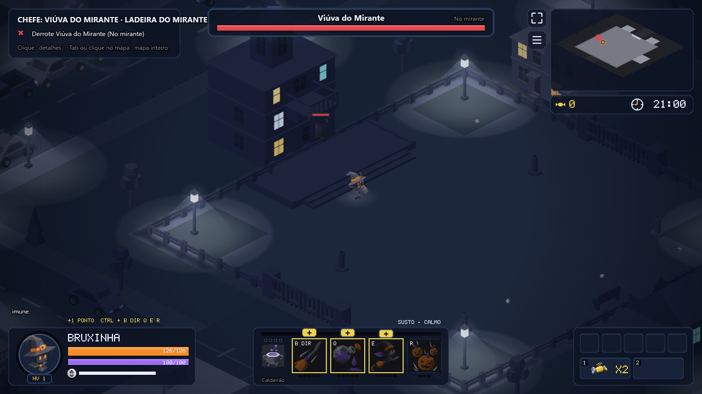 |
|                            Chefe: Síndico Zeloso                             |                           Chefe: Viúva do Mirante                           |
|     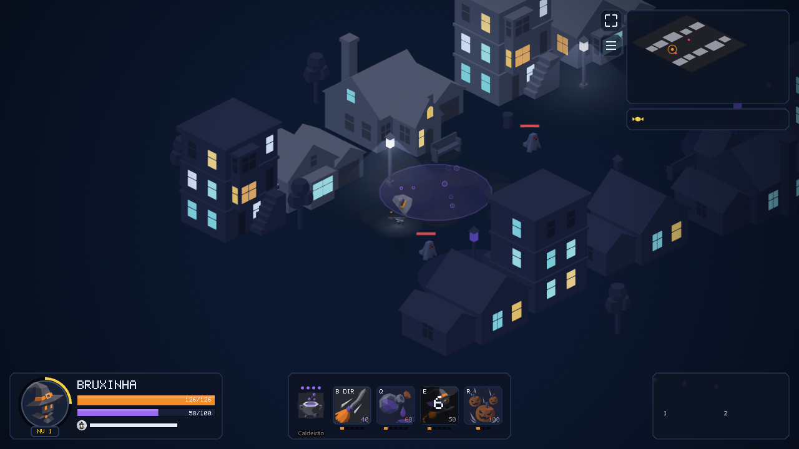     | 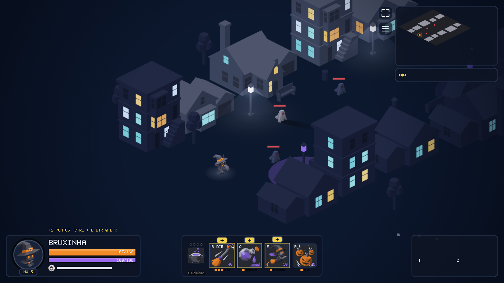  |
|                           Habilidades Q, W, E e R                            |                      Evolução escolhida no meio da run                      |
| 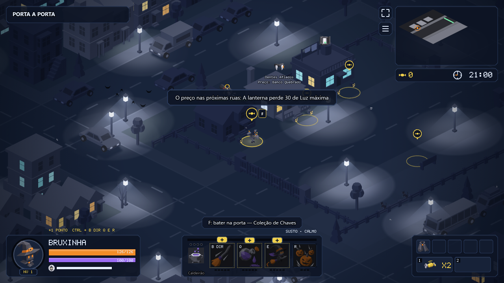 |  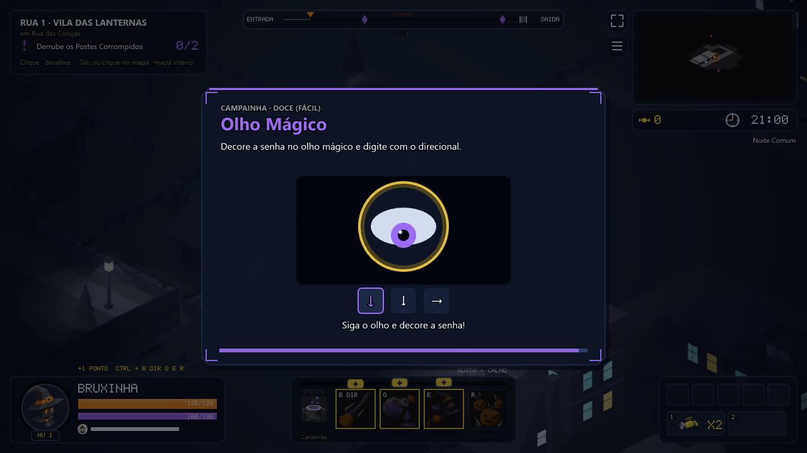  |
|                       O preço do trato aparece na rua                        |                        Minijogo da Casa Desconfiada                         |
|       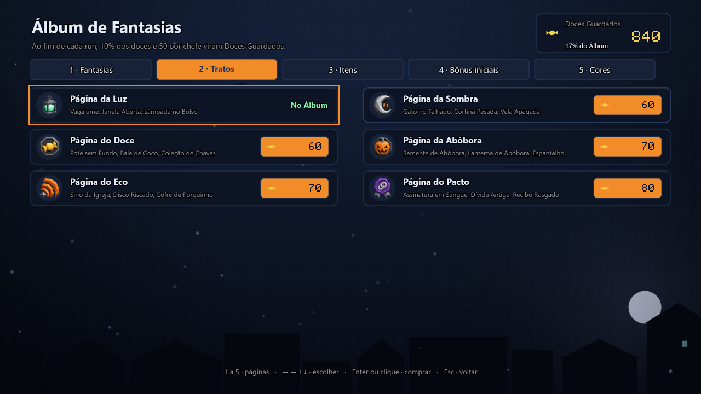       |           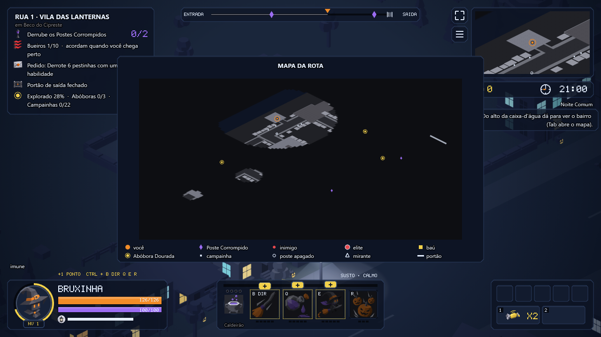           |
|                  Álbum de Fantasias (progressão entre runs)                  |                          Mapa da rota e objetivos                           |

## O que tem no jogo

- **4 campeões** com kits próprios de habilidades, passivas e evoluções.
- **3 bairros**, cada um com ruas, quintais, Postes Corrompidos, elites e um chefe com fases.
- **Tratos e preços:** cada poder aceito traz uma maldição permanente que muda o cenário.
- **Modos:** Noite curta (cerca de 15 minutos), Run completa, Semente da noite (a mesma noite para
  todos, uma por dia), Desafio da semana e Rua de treino.
- **Progressão entre runs:** Álbum de Fantasias, Diário do Bairro, maestria e Lua Cheia
  (níveis de dificuldade).
- **Acessibilidade e conforto:** dicas que podem ser desligadas, minijogos com folga, mira
  automática opcional, controle (gamepad) e dois níveis de desempenho gráfico.

### Controles

| Ação                       | Tecla                         |
| -------------------------- | ----------------------------- |
| Andar                      | `W` `A` `S` `D`               |
| Ataque básico              | Botão esquerdo do mouse       |
| Habilidades                | Botão direito, `Q`, `E` e `R` |
| Rolar                      | `Espaço`                      |
| Lanterna                   | `Shift`                       |
| Bater na porta / interagir | `F`                           |
| Travessura                 | `G`                           |

## Como foi construído

O projeto separa **regra** de **tela**, o que deixa o jogo inteiro testável sem abrir o navegador:

```
content/      28 arquivos JSON com todo o conteúdo e o balanceamento, validados por Zod
src/sim/      simulação pura em passo fixo de 1/60 s, sem Phaser e sem DOM (roda em Node)
src/render/   cenário isométrico desenhado por código: prismas, luz, sombras e paleta
src/game/     Phaser: cenas, entrada, interface, áudio e save
src/bots/     bots que jogam a run inteira para validar o balanceamento
tests/        Vitest (unidade) e Playwright (ponta a ponta no build de produção)
desktop/      inicializador Electron das edições Windows e Linux
```

Decisões técnicas que valem destacar:

- **Simulação determinística.** Passo fixo e gerador de números com semente; `Math.random` é proibido
  por regra de lint. A mesma semente gera a mesma noite, o que permite o modo "Semente da noite" e
  testes reproduzíveis.
- **Conteúdo como dado.** Habilidades, inimigos, tratos e preços são JSON interpretados por
  executores genéricos. Mudar o balanceamento não exige mexer no código.
- **A tela nunca decide regra.** A entrada vira comando na fila do mundo, e o render só interpola
  entre o estado anterior e o atual.
- **Arte por código.** O cenário é feito de primitivas desenhadas em `src/render`, com geometria pura
  testada em Node. Isso mantém o build leve (cerca de 14 MB na versão para navegador).
- **Testes em várias camadas.** São 758 testes unitários e 115
  testes de ponta a ponta com screenshots, além de bots que simulam centenas de runs.
- **CI no GitHub Actions** com lint, tipos, testes, build e testes de ponta a ponta. Um passo opcional
  publica no itch.io com o butler.

A arquitetura completa e as regras do projeto estão em [`docs/ARQUITETURA.md`](docs/ARQUITETURA.md),
e o design do jogo em [`docs/GDD.md`](docs/GDD.md) e [`docs/GAMEPLAY.md`](docs/GAMEPLAY.md).

## Rodar localmente

Requisitos: Node.js 22.12 ou mais recente.

```bash
npm install
npm run dev            # servidor de desenvolvimento
npm run check          # lint, tipos, testes unitários e build
npm run test:e2e       # Playwright no build de produção
npm run empacotar      # gera os pacotes para navegador e Windows
```

## Autoria e uso de IA

Criação, game design e direção do projeto: **Emanuel Cândido**. Escrevi o documento de design
(GDD), defini as regras, a arquitetura e o estilo visual, e conferi cada etapa jogando e revisando
os screenshots.

O desenvolvimento foi feito com assistentes de IA (Claude Code e Codex) a partir do GDD, e parte das
artes da interface e dos modelos 3D foi gerada com ferramentas de IA. Esse uso também está declarado
na página do itch.io. Os áudios gravados são CC0. Créditos e licenças completos estão em
[`docs/CREDITS.md`](docs/CREDITS.md).

> O acervo de trabalho de arte (pranchas, modelos GLB e arquivos do Blender) não faz parte deste
> repositório. As artes prontas que o jogo usa estão em `public/` e `src/render/malhas/`.
