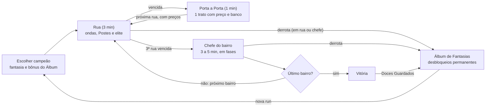

# Porta a Porta: documento de design para o Claude Code

13/10/2026 · @Emanuel

> Fonte: `docs/GDD.pdf` (original). A imagem de referência do estilo está em
> `docs/estilo/referencia.png` quando adicionada ao repositório.

## Visão geral

Porta a Porta é um roguelite de ação isométrica para navegador: uma criança fantasiada luta pelas
ruas de um bairro assombrado com habilidades Q, W, E e R, no estilo de combate dos MOBAs, e aceita
tratos dos moradores que dão poder mas estragam o bairro para sempre naquela run. Cada run dura
cerca de 45 minutos, e o jogo inteiro rende 4+ horas.

A história em uma frase: na noite de Halloween, o Dono do Bairro, uma casa antiga de três andares,
comprou cada morador com tratos, e só uma criança que bate de porta em porta pode juntar poder
suficiente para enfrentá-lo, pagando o mesmo preço que todos pagaram.

### Pilares do design

- **Luta de MOBA, sozinho:** skillshots mirados, recargas, mana, ultimate e posicionamento. Acertar
  e desviar é a habilidade principal do jogador.
- **Poder sempre tem preço:** os melhores itens são tratos com maldição, e a maldição muda o mapa
  (postes apagados, ruas escuras, casas que perseguem).
- **O bairro conta a sua run:** basta olhar a rua para ver os tratos que você aceitou, sem menu.
- **Luz é terreno:** a luz dos postes e das janelas funciona como o "mato" do MOBA, definindo quem
  te vê, onde você se cura e onde a sombra caça.
- **Feito para IA:** tudo é desenhado por código, todo número fica em JSON e a simulação roda sem
  tela, para bots testarem e balancearem.

### Decisões-chave

| Decisão       | Escolha                                                                                   |
| ------------- | ----------------------------------------------------------------------------------------- |
| Gênero        | Roguelite de ação isométrica com habilidades Q, W, E e R                                  |
| Modo          | Um jogador, mouse e teclado, com controle opcional                                        |
| Plataforma    | Navegador (HTML5) no itch.io, 1280 × 720                                                  |
| Engine        | Phaser 4 com TypeScript e Vite                                                            |
| Arte          | Low-poly isométrico em tons de cinza, gerado por código (ver Estilo visual)               |
| Run           | 3 bairros, cada um com 3 ruas e um chefe, cerca de 45 min                                 |
| Duração total | 4+ horas, com 4 campeões e 10 níveis de dificuldade                                       |
| Originalidade | Só o estilo de combate dos MOBAs, com personagens, nomes, ícones e efeitos 100% originais |

## Estilo visual

O jogo segue a imagem de referência: um bairro low-poly isométrico, quase todo em cinzas, sem
contornos nem texturas, em que a única luz vem das janelas e dos postes. Tudo é desenhado por código
com polígonos de cor chapada, então a IA produz qualquer casa, rua ou personagem sem precisar de
ilustração.

### O que a imagem mostra, e vira regra

- **Fundo:** um plano único cinza-azulado, liso, sem grama nem textura de chão.
- **Prédios:** volumes simples (casa térrea com garagem, sobrado de três andares com escada lateral
  e janela saliente, casa grande com vários telhados e chaminé). Telhados de duas águas, sem
  detalhes de telha.
- **Sombreamento por face:** cada volume tem três tons, com o topo mais claro, a face esquerda média
  e a face direita mais escura. Não há gradientes.
- **Sombras projetadas:** longas, chapadas e semitransparentes, caindo para a esquerda e para baixo,
  porque a luz vem do alto à direita.
- **Luz:** janelas em branco quase puro, como se a luz viesse de dentro, e a cabeça do poste acesa.
  É o único brilho da cena.
- **Objetos da rua:** poste com luminária, lixeira, árvore de copa redonda feita de 3 esferas e
  banco de praça. Todos no mesmo cinza dos prédios.

### Paleta base (valores iniciais a confirmar na aprovação de estilo)

| Uso                        | Cor                         | Hex       |
| -------------------------- | --------------------------- | --------- |
| Chão e fundo               | Cinza-azulado               | `#6B6C76` |
| Topo de telhados e volumes | Grafite claro               | `#4E4F57` |
| Face esquerda              | Grafite médio               | `#3C3D44` |
| Face direita               | Grafite escuro              | `#2C2D33` |
| Sombra projetada           | Preto com 35% de opacidade  | `#000000` |
| Janela e luz do poste      | Branco frio                 | `#EEF1F6` |
| Halo de luz no chão        | Branco com 12% de opacidade | `#FFFFFF` |

### Cores de acento (só para jogabilidade)

O cenário nunca usa cor. As cores abaixo existem só em personagens, habilidades e alertas, o que faz
a ação saltar do fundo cinza.

| Significado                     | Cor             | Hex       |
| ------------------------------- | --------------- | --------- |
| Jogador e habilidades amigas    | Laranja abóbora | `#F28C28` |
| Magia e tratos                  | Roxo            | `#9B6CF2` |
| Fantasmas e cura                | Verde fantasma  | `#7CF2B0` |
| Perigo, aviso de ataque inimigo | Vermelho        | `#E5484D` |
| Doces e moedas                  | Amarelo         | `#F2D14B` |

### Geometria e câmera

- Projeção isométrica 2:1 (tile de 64 × 32 px), câmera fixa, sem rotação, com zoom de 0,8× a 1,2×.
- Prédios ocupam de 2 × 2 a 4 × 3 tiles, com altura em múltiplos de 24 px por andar.
- Personagens têm cerca de 32 px de altura: corpo em prisma, cabeça em bloco e silhueta da fantasia
  (chapéu de bruxa, lençol de fantasma, costelas, capa). Os olhos ou um detalhe brilham na cor de
  acento.
- Inimigos são do cinza do cenário, mas com olhos brilhantes, para parecer que o bairro ganhou vida.

### Iluminação no jogo

- Uma camada de escuridão cobre a rua, e cada fonte de luz "recorta" um círculo nela: poste com
  raio de 3 tiles, janela acesa com 1,5 tile e lanterna do jogador com 2 tiles.
- Poste amigo é branco frio; Poste Corrompido emite luz roxa e pisca.
- Quando um trato apaga um poste, ele fica cinza, sem halo, até o fim da run. Uma rua escura perde
  todos os recortes, exceto a lanterna.

### Efeitos e leitura da ação

- Habilidades usam formas geométricas chapadas (linhas, cones, círculos) com partículas quadradas
  simples.
- Todo ataque inimigo forte é anunciado no chão com uma área vermelha que se enche antes do impacto
  (0,5 a 1,2 s).
- Números de dano em fonte pixel, em branco, e em amarelo para críticos.
- Interface mínima e semitransparente, na mesma paleta: barra de Coragem, barra de Energia, os 4
  ícones Q, W, E, R com contagem de recarga e o Relógio da Meia-Noite no canto.

## Estrutura da run

Uma run atravessa 3 bairros, cada um com 3 ruas de luta e um chefe, e entre as ruas o jogador bate
de porta em porta para aceitar tratos. Os preços aceitos são aplicados nas ruas seguintes, então o
bairro vai ficando mais escuro e perigoso conforme o jogador fica mais forte.

_Cada rua vencida leva a uma porta com tratos, e os preços mudam as ruas seguintes:_



### Uma rua, passo a passo

1. O jogador entra pelo portão, com a calçada iluminada por postes amigos.
2. A cada 25 s chega uma onda de pestinhas pela rua; os quintais atrás das casas guardam selvagens
   opcionais.
3. Dois Postes Corrompidos (roxos) defendem a rua. Destruir os dois abre o portão da saída.
4. A partir da segunda rua, uma elite aparece no meio da luta.
5. Ao sair, a rua vencida fica para trás e começa a fase Porta a Porta.

### Os 3 bairros

| Bairro                | Clima                              | Novidade                             | Chefe            |
| --------------------- | ---------------------------------- | ------------------------------------ | ---------------- |
| 1. Vila das Lanternas | Ruas bem iluminadas, casas térreas | Ensina luta, Postes e tratos         | Síndico Zeloso   |
| 2. Ladeira do Mirante | Sobrados altos, mais sombra        | Sombras Rasteiras e quintais maiores | Viúva do Mirante |
| 3. Alameda do Dono    | Casas grandes, quase sem postes    | Todas as elites e Postes mais fortes | O Dono do Bairro |

## Combate

O combate é em tempo real, com movimento por clique ou WASD, auto-ataque e quatro habilidades
miradas no cursor. O jogador vence acertando skillshots, desviando das áreas vermelhas e usando a
luz e a sombra a seu favor.

### Controles

| Ação                   | Mouse e teclado                     | Controle                                                |
| ---------------------- | ----------------------------------- | ------------------------------------------------------- |
| Mover                  | Botão direito ou WASD               | Analógico esquerdo                                      |
| Auto-ataque            | Botão direito sobre o inimigo, ou A | Gatilho direito                                         |
| Habilidades            | Q, W, E, R, miradas no cursor       | X, Y, B, gatilho esquerdo, miradas no analógico direito |
| Lanterna (pulso)       | Espaço                              | A                                                       |
| Usar doce (consumível) | 1 e 2                               | Direcional                                              |
| Ver alcances e mapa    | Shift e Tab                         | Botões de ombro                                         |

As habilidades são de lançamento rápido: ao apertar, a área aparece no chão enquanto a tecla estiver
pressionada, e a habilidade sai ao soltar. Há uma opção para lançar direto ao apertar.

### Atributos

| Atributo    | Valor inicial                 | O que faz                                                         |
| ----------- | ----------------------------- | ----------------------------------------------------------------- |
| Coragem     | 100 a 160, conforme o campeão | Vida. Em 0, a run termina                                         |
| Energia     | 100                           | Paga as habilidades e regenera 4 por segundo                      |
| Força       | 10                            | Escala o auto-ataque e as habilidades físicas                     |
| Feitiço     | 0                             | Escala as habilidades mágicas                                     |
| Resistência | 10                            | Reduz o dano recebido                                             |
| Pressa      | 0                             | Reduz a recarga das habilidades, no máximo 40                     |
| Velocidade  | 3,5 tiles por segundo         | Movimento                                                         |
| Luz         | 100                           | Carga da lanterna; gasta 25 por pulso e recarrega perto de postes |

### Fórmulas

```
dano final  = (base + razão × atributo) × 100 / (100 + Resistência do alvo)
recarga     = recarga base × (1 − Pressa / 100), com Pressa no máximo 40
crítico     = 150% do dano, chance base de 0%
```

**Níveis na run:** derrotar inimigos dá Experiência. O jogador vai do nível 1 ao 12 em cada run e
ganha 1 ponto de habilidade por nível. Q, W e E chegam ao posto 5, e o R só pode subir nos níveis 4,
8 e 12. Cada nível dá +8% de Coragem e +2 de Força ou Feitiço, conforme o campeão.

### Estados

| Estado       | Efeito                                                               |
| ------------ | -------------------------------------------------------------------- |
| Lentidão     | Reduz a velocidade em porcentagem                                    |
| Atordoamento | Impede mover, atacar e lançar habilidades                            |
| Enraizamento | Impede mover, mas permite atacar                                     |
| Medo         | O alvo foge do causador, sem controle                                |
| Marca        | O próximo dano contra o alvo ganha um bônus definido pela habilidade |
| Escudo       | Absorve dano antes da Coragem                                        |
| Invisível    | Inimigos não miram o alvo; atacar quebra o efeito                    |

Chefes não podem ser atordoados nem enraizados. Em vez disso, ficam 50% mais lentos pela metade do
tempo.

### A regra da luz

Cada tile da rua está iluminado (perto de um poste amigo, uma janela acesa ou a lanterna) ou na
sombra, e isso muda o combate:

|                     | Na luz                                                                           | Na sombra                                           |
| ------------------- | -------------------------------------------------------------------------------- | --------------------------------------------------- |
| Jogador             | Recupera 2% de Coragem por segundo fora de combate e recarrega a Luz da lanterna | Some da visão dos inimigos vigias a mais de 2 tiles |
| Criaturas da sombra | Não entram e recuam                                                              | Ganham 30% de velocidade                            |
| Vigias e torres     | Enxergam o jogador de longe                                                      | Só enxergam o jogador a até 2 tiles                 |

**Lanterna:** o pulso (Espaço) ilumina um raio de 3 tiles por 2 s, empurra criaturas da sombra 2
tiles para trás e revela inimigos invisíveis. Custa 25 de Luz.

**Fora de combate:** depois de 4 s sem causar ou receber dano, o jogador anda 20% mais rápido.

## Campeões

Cada fantasia é um campeão com uma passiva e quatro habilidades, e cada uma joga de um jeito: a
Bruxinha controla à distância, o Fantasma entra e sai da sombra para matar, o Esqueleto aguenta tudo
e o Vampirinho vive de roubar vida. Os números abaixo são valores iniciais; o formato "60 / 180"
significa posto 1 / posto 5 (ou posto 1 / posto 3 no R), com crescimento linear entre eles.

| Campeão    | Papel                     | Coragem | Atributo principal  | Desbloqueio       |
| ---------- | ------------------------- | ------- | ------------------- | ----------------- |
| Bruxinha   | Maga de longo alcance     | 100     | Feitiço             | Inicial           |
| Fantasma   | Assassino                 | 110     | Força               | Vencer o bairro 1 |
| Esqueleto  | Tanque                    | 160     | Força e Resistência | Vencer o bairro 2 |
| Vampirinho | Lutador com roubo de vida | 130     | Força               | Vencer uma run    |

### Bruxinha

**Passiva: Caldeirão.** A cada 4 habilidades lançadas, a próxima causa 50% de dano extra e solta uma
pequena explosão roxa.

| Tecla | Habilidade         | Efeito                                                         | Números                            | Energia | Recarga   |
| ----- | ------------------ | -------------------------------------------------------------- | ---------------------------------- | ------- | --------- |
| Q     | Vassoura Disparada | Projétil em linha de 8 tiles, acerta o primeiro inimigo        | 60 / 180 + 60% Feitiço             | 40      | 6 s       |
| W     | Poção Pegajosa     | Área de raio 2 tiles que fica 3 s no chão e deixa lento em 40% | 40 / 120 + 40% Feitiço por segundo | 60      | 12 s      |
| E     | Salto de Vassoura  | Dash de 4 tiles na direção do cursor, atravessando inimigos    | Sem dano                           | 50      | 14 / 10 s |
| R     | Chuva de Abóboras  | Após 0,8 s, 3 ondas de abóboras numa área de raio 3 tiles      | 150 / 350 + 80% Feitiço por onda   | 100     | 90 / 60 s |

### Fantasma

**Passiva: Arrepio.** O primeiro ataque depois de sair da sombra é crítico garantido e assusta
pestinhas (Medo de 1 s).

| Tecla | Habilidade      | Efeito                                                                                                   | Números                                                           | Energia | Recarga   |
| ----- | --------------- | -------------------------------------------------------------------------------------------------------- | ----------------------------------------------------------------- | ------- | --------- |
| Q     | Arranhão Gélido | Corte em linha de 4 tiles que atravessa todos os inimigos                                                | 50 / 170 + 90% Força                                              | 30      | 5 s       |
| W     | Atravessar      | Dash de 3 tiles que passa através de paredes e casas                                                     | Sem dano                                                          | 40      | 16 / 10 s |
| E     | Lençol          | Invisível por 3 s na sombra ou 1,5 s na luz, com 30% de velocidade                                       | Sem dano                                                          | 60      | 18 / 12 s |
| R     | Assombração     | Marca um alvo a até 6 tiles; após 1 s aparece atrás dele e o golpeia. Se o alvo cair, a recarga reinicia | 200 / 400 + 120% Força, dobrado em alvos abaixo de 30% de Coragem | 100     | 80 / 50 s |

### Esqueleto

**Passiva: Remontar.** Uma vez por bairro, ao chegar a 0 de Coragem, desmonta por 2 s e volta com 30%
de Coragem.

| Tecla | Habilidade         | Efeito                                                                                                                               | Números                         | Energia | Recarga    |
| ----- | ------------------ | ------------------------------------------------------------------------------------------------------------------------------------ | ------------------------------- | ------- | ---------- |
| Q     | Soco de Osso       | Golpe em cone curto que atordoa por 0,75 s                                                                                           | 70 / 190 + 70% Força            | 35      | 7 s        |
| W     | Escudo de Costelas | Escudo por 4 s; se não quebrar, devolve 50% em Coragem                                                                               | 80 / 240 + 10% Coragem máxima   | 50      | 14 s       |
| E     | Investida          | Corre 5 tiles e empurra os inimigos no caminho para o lado                                                                           | 60 / 180 + 50% Força            | 45      | 12 / 8 s   |
| R     | Ossuário           | Anel de ossos de raio 3 tiles por 2,5 s; inimigos dentro não saem e são provocados a atacar o Esqueleto, que ganha 40 de Resistência | 100 / 300 + 60% Força ao fechar | 100     | 100 / 70 s |

### Vampirinho

**Passiva: Sede.** Recupera 10% do dano causado como Coragem, e 20% quando está na sombra.

| Tecla | Habilidade      | Efeito                                                                                   | Números              | Energia | Recarga   |
| ----- | --------------- | ---------------------------------------------------------------------------------------- | -------------------- | ------- | --------- |
| Q     | Mordida         | Salta 2 tiles até o alvo e morde, curando 50% do dano causado                            | 60 / 180 + 80% Força | 40      | 6 s       |
| W     | Capa de Morcego | Vira morcegos por 0,5 s, ignorando todo dano, e reaparece a 3 tiles                      | Sem dano             | 50      | 15 / 10 s |
| E     | Névoa           | Nuvem de raio 2,5 tiles por 4 s que vira sombra e reduz 30% do dano recebido dentro dela | Sem dano             | 60      | 16 s      |
| R     | Banquete        | Por 6 s, o roubo de vida sobe para 100% e cada golpe dá 5% de velocidade, até 30%        | Sem dano direto      | 100     | 90 / 60 s |

**Regras de design para novos campeões:** uma habilidade de dano principal (Q), uma de controle ou
defesa (W), uma de mobilidade (E) e uma ultimate que muda o rumo da luta (R). Toda habilidade nova
entra como dados em JSON e um handler com teste.

## Inimigos, elites e chefes

Os inimigos seguem a lógica de um MOBA: ondas de pestinhas pela rua, selvagens nos quintais, torres
(os Postes Corrompidos) a destruir, elites com habilidades próprias e um chefe por bairro. Todos são
do cinza do cenário, com olhos que brilham, e todo ataque forte é anunciado no chão com uma área
vermelha.

**Como a IA dos inimigos funciona:** cada inimigo é uma máquina de estados simples (patrulhar,
perseguir, anunciar ataque, atacar, recuar). As ondas seguem um campo de fluxo até o jogador, e os
demais usam A\* na grade. Os números de vida abaixo são do bairro 1, e crescem 60% no bairro 2 e
140% no bairro 3.

### Pestinhas (ondas a cada 25 s, 4 a 6 por onda)

| Inimigo              | Coragem | Comportamento                                                          | Recompensa         |
| -------------------- | ------- | ---------------------------------------------------------------------- | ------------------ |
| Pestinha de Lençol   | 60      | Corpo a corpo, avança direto, 8 de dano por golpe                      | 6 de XP e 2 doces  |
| Arremessador de Ovos | 40      | Mantém 5 tiles de distância e joga ovos (projétil lento, 10 de dano)   | 7 de XP e 2 doces  |
| Abóbora-Canhão       | 90      | Lenta; para, anuncia por 1 s e explode em raio de 2 tiles (25 de dano) | 10 de XP e 4 doces |

### Selvagens (nos quintais, não reaparecem)

| Inimigo         | Coragem | Comportamento                                                              | Bônus ao derrotar           |
| --------------- | ------- | -------------------------------------------------------------------------- | --------------------------- |
| Cão de Guarda   | 220     | Investida em linha reta de 5 tiles, anunciada por 0,8 s                    | +15% de velocidade por 60 s |
| Corvo da Árvore | 80      | Não ataca; ao ver o jogador, grita e atrai os inimigos num raio de 6 tiles | A rua perde o alarme        |
| Gato Preto      | 150     | Foge do jogador; se for pego, dá um trato extra sem preço                  | 1 trato grátis              |

### Torres: Postes Corrompidos (2 por rua)

Cada um tem 600 de Coragem, alcance de 5 tiles e atira 1 projétil roxo por segundo (20 de dano, +10%
a cada tiro seguido no mesmo alvo). Ele mira primeiro as pestinhas que estão perto e só depois o
jogador, então avançar junto com as próprias distrações é a estratégia certa. Destruir os dois abre o
portão da próxima rua.

### Elites (1 por rua a partir da segunda)

| Elite             | Coragem | Habilidades                                                                                                              | Como vencer                                                  |
| ----------------- | ------- | ------------------------------------------------------------------------------------------------------------------------ | ------------------------------------------------------------ |
| Casa Perseguidora | 900     | Persegue devagar (1,5 tile/s); Pisão em raio de 2 tiles anunciado por 1,2 s; ao ficar abaixo de 50%, invoca 2 pestinhas  | Ficar longe, punir depois de cada Pisão                      |
| Vizinho Curioso   | 400     | Cone de visão de 6 tiles; ao ver o jogador, dá +30% de dano às pestinhas por 10 s; foge para dentro da casa mais próxima | Chegar pela sombra e derrubá-lo antes do alerta              |
| Cobrador          | 700     | Marca o jogador; cada trato aceito aumenta o dano dele em 10%; arremessa uma corrente que puxa 3 tiles                   | Desviar da corrente, ou pagar a dívida em doces antes da rua |
| Sombra Rasteira   | 500     | Só anda na sombra, com 30% mais velocidade; some na luz e reaparece no canto escuro mais próximo                         | Lutar perto de postes e usar o pulso da lanterna             |

A Casa Perseguidora e a Sombra Rasteira também nascem dos tratos (ver Tratos e economia).

### Chefes (um no fim de cada bairro)

**Síndico Zeloso (bairro 1, 2.500 de Coragem)**

- Fase 1: anda pela praça e lança Multa, um projétil em leque de 3 direções. A cada 15 s, fecha um
  Portão, uma linha de grades que divide a arena por 6 s.
- Fase 2 (abaixo de 50%): chama 2 Guardas de Condomínio (300 cada) e passa a usar Vistoria, uma área
  de 4 × 4 tiles que fica vermelha por 1,2 s e atordoa quem estiver dentro.
- Vencê-lo ensina a ler áreas anunciadas e a lidar com adds.

**Viúva do Mirante (bairro 2, 4.000 de Coragem)**

- Fase 1: fica no alto da casa e lança Lágrimas, círculos pequenos que caem em sequência seguindo o
  jogador.
- Fase 2 (abaixo de 60%): apaga todos os postes da arena. Só a lanterna e as janelas da casa dela
  iluminam, e Sombras Rasteiras surgem a cada 10 s.
- Fase 3 (abaixo de 25%): desce e luta corpo a corpo, alternando investida e véu (fica invisível por
  2 s).
- Vencê-la ensina a usar a lanterna e a regra da luz sob pressão.

**O Dono do Bairro (bairro 3, 6.500 de Coragem)**

É a casa grande de três andares da imagem de referência, e cada andar é uma fase.

- Andar 1: janelas atiram feixes de luz roxa que varrem a arena; portas se abrem e soltam pestinhas.
- Andar 2: a chaminé lança tijolos em áreas anunciadas, e a escada vira uma rampa que empurra o
  jogador.
- Andar 3: o telhado vira um rosto e ele usa Cobrança: para cada trato aceito na run, invoca o eco
  daquele preço (um poste que se apaga, uma Casa Perseguidora, uma área escura). Quanto mais tratos,
  mais difícil o final.
- Vencê-lo encerra a run com vitória.

**Chefe secreto: A Moradora do 13 (a partir da dificuldade Lua Cheia 5)**

Só aparece se o jogador terminou o bairro 3 com zero tratos ativos. Ela copia as 4 habilidades do
campeão do jogador, num duelo espelhado.

## Tratos e economia

O poder vem de duas fontes: itens comuns, comprados com doces, e tratos, que são de graça mas cobram
um preço permanente no bairro. Os tratos são o coração do jogo, porque o jogador precisa deles para
vencer o Dono do Bairro, e cada um deixa a run mais perigosa.

### A fase Porta a Porta (entre as ruas, cerca de 1 min)

1. O portão abre para uma calçada calma, sem inimigos, com 3 casas de janela acesa e um banco.
2. Cada janela acesa oferece um trato, mostrando o poder e o preço antes de bater.
3. O jogador aceita no máximo 1 trato por fase (o Gato Preto dá um segundo).
4. Pechinchar: pagar 100 doces sorteia outro preço para o mesmo poder, uma vez por casa.
5. O banco funciona como loja de itens comuns e cura 30% da Coragem.
6. Recusar todos os tratos dá 80 doces de "bom vizinho".

### Os preços (permanentes até o fim da run)

| Preço                | Efeito no bairro                                         | Efeito no combate                                  |
| -------------------- | -------------------------------------------------------- | -------------------------------------------------- |
| Poste Apagado        | 1 poste amigo de cada rua seguinte nasce apagado         | Menos cura e mais terreno para a Sombra Rasteira   |
| Rua Sem Luz          | A próxima rua não tem nenhum poste nem janela            | Só criaturas da sombra, e a lanterna é a única luz |
| Casa Perseguidora    | Uma casa ganha olhos e anda                              | Uma elite Casa Perseguidora extra em todas as ruas |
| Janelas Fechadas     | Cada fase Porta a Porta passa a ter 1 casa acesa a menos | Menos tratos e escolhas mais pobres                |
| Banco Quebrado       | O banco some das fases Porta a Porta                     | Sem loja e sem cura entre as ruas                  |
| Vizinhança Atenta    | Mais janelas com olhos                                   | +1 Vizinho Curioso por rua                         |
| Dívida               | O Cobrador passa a aparecer nas ruas                     | O dano dele cresce com cada trato                  |
| Lanterna Fraca       | A lanterna perde 30 de Luz máxima                        | Menos pulsos e um círculo de luz menor             |
| Ondas Famintas       | As pestinhas chegam a cada 20 s em vez de 25 s           | Mais pressão e mais doces                          |
| Meia-Noite Adiantada | O Relógio da Meia-Noite começa 2 min adiantado           | Menos tempo antes do aumento de dificuldade        |

### Exemplos de tratos (poderes)

| Trato               | Morador              | Poder                                                          |
| ------------------- | -------------------- | -------------------------------------------------------------- |
| Relógio de Bolso    | Senhor do Relógio    | +20 de Pressa                                                  |
| Dentes Afiados      | Dentista Sorridente  | Auto-ataques causam +40% de dano                               |
| Segundo Fôlego      | Enfermeira da Noite  | +60 de Coragem máxima e um escudo de 20% ao entrar em cada rua |
| Mira Torta          | Menino do Estilingue | Skillshots ganham 30% de alcance e velocidade                  |
| Lua no Bolso        | Astrônoma            | O R recarrega 35% mais rápido                                  |
| Sombra Amiga        | Senhora das Cortinas | Na sombra, +15% de dano e de velocidade                        |
| Eco                 | Cantora da Varanda   | O Q se repete 0,5 s depois com 40% do dano                     |
| Ímã de Doces        | Doceira              | Doces vêm até o jogador e valem 50% mais                       |
| Corrente de Abóbora | Jardineiro           | Inimigos derrotados explodem com 20% da Coragem deles          |
| Pacto do Porão      | Homem do Porão       | +30 de Força ou Feitiço                                        |
| Casca Grossa        | Tartaruga do Aquário | +25 de Resistência, mas -10% de velocidade                     |
| Chave Mestra        | Chaveiro             | Abre 1 porta trancada por rua com um baú de 120 doces          |

Cada trato tem um preço sorteado entre 2 ou 3 preços possíveis, e os tratos mais fortes só aparecem
com os preços mais pesados.

### Itens comuns (no banco, com doces)

| Item                           | Preço | Efeito                     |
| ------------------------------ | ----- | -------------------------- |
| Chapéu Pontudo                 | 250   | +15 de Feitiço             |
| Taco de Beisebol               | 250   | +15 de Força               |
| Capa Grossa                    | 200   | +12 de Resistência         |
| Tênis de Luzinha               | 200   | +10% de velocidade         |
| Ampulheta                      | 300   | +12 de Pressa              |
| Pote de Mel                    | 350   | +10% de roubo de vida      |
| Pirulito (consumível)          | 60    | Cura 25% da Coragem em 3 s |
| Bala Efervescente (consumível) | 80    | Recupera 50 de Energia     |

O jogador carrega até 5 itens e 2 consumíveis. Os tratos não ocupam espaço.

**Economia de doces:** uma rua rende cerca de 100 a 150 doces (pestinhas, selvagens, elite e
Postes). Assim o jogador compra cerca de um item comum a cada duas ruas, o que mantém os tratos como
a fonte principal de poder.

## Progressão e duração de 4+ horas

Uma run vitoriosa dura cerca de 45 minutos, e o jogo chega a 4+ horas porque o jogador perde as
primeiras runs, desbloqueia campeões e volta para testar tratos e builds novas. Entre as runs, o
progresso fica no Álbum de Fantasias.

### Duração de uma run

| Etapa                      | Duração   | Por bairro | Por run (3 bairros) |
| -------------------------- | --------- | ---------- | ------------------- |
| Rua (ondas, Postes, elite) | 3 min     | 3 ruas     | 27 min              |
| Fase Porta a Porta         | 1 min     | 2          | 6 min               |
| Chefe                      | 3 a 5 min | 1          | 12 min              |
| **Total**                  |           | 15 min     | 45 min              |

**Relógio da Meia-Noite:** a run começa às 21h no relógio do jogo, e cada minuto real avança 4
minutos. Ao bater meia-noite (45 minutos reais), os inimigos ganham +10% de Coragem e de dano por
minuto. Isso impede o jogador de ficar farmando e cria a dúvida entre explorar quintais e seguir em
frente.

### Conta das 4+ horas

| Etapa                                                      | Runs | Tempo           |
| ---------------------------------------------------------- | ---- | --------------- |
| Primeiras runs com a Bruxinha (derrotas nos bairros 1 e 2) | 3    | cerca de 1 h 15 |
| Primeira vitória                                           | 1    | 45 min          |
| Runs com Fantasma, Esqueleto e Vampirinho                  | 3    | cerca de 2 h 15 |
| **Total até ver a maior parte do conteúdo**                | 7    | cerca de 4 h 15 |

### Álbum de Fantasias (meta-progressão)

Ao fim de cada run, 10% dos doces ganhos viram Doces Guardados, mais 50 por chefe derrotado. Eles
compram desbloqueios permanentes:

| Desbloqueio                                                          | Início | Máximo |
| -------------------------------------------------------------------- | ------ | ------ |
| Campeões                                                             | 1      | 4      |
| Tratos disponíveis                                                   | 12     | 30     |
| Itens comuns                                                         | 6      | 14     |
| Pequenos bônus iniciais (+5% Coragem, +50 doces, +1 reroll de preço) | 0      | 6      |
| Cores alternativas das fantasias                                     | 0      | 8      |

**Lua Cheia (dificuldade):** depois da primeira vitória, o jogador escolhe níveis de 1 a 10, e cada
nível soma um modificador: inimigos com +15% de Coragem (1), Postes atirando mais rápido (2), 1 preço
extra aleatório no início (3), Relógio da Meia-Noite 5 min adiantado (4), A Moradora do 13 liberada
(5) e assim até o nível 10, com todos juntos.

**Semente da noite:** uma vez por dia, uma run com a mesma semente para todos os jogadores, com placar
local de tempo e dano.

## Tecnologia e arquitetura do código

O jogo usa Phaser 4 com TypeScript e Vite, e a regra mais importante da arquitetura é separar a
simulação (regras, combate, inimigos) do desenho na tela. Assim os bots jogam milhares de lutas em
Node, sem navegador. A última versão do Phaser citada no documento original é a 4.1.0, de 30/04/2026;
na criação do repositório (13/10/2026) o npm tinha a **4.2.1**, que foi a fixada.

| Camada                  | Tecnologia                                  | Por quê                                                              |
| ----------------------- | ------------------------------------------- | -------------------------------------------------------------------- |
| Engine 2D               | Phaser 4                                    | Cenas, input, áudio e desenho de polígonos no navegador              |
| Linguagem               | TypeScript em modo strict                   | O compilador pega erros que a IA cometeria sem perceber              |
| Build                   | Vite                                        | Recarga instantânea e build estático para o itch.io                  |
| Testes de regras e bots | Vitest                                      | Roda a simulação em Node, rápido e sem tela                          |
| Testes de tela          | Playwright                                  | Abre o jogo, joga uma rua e tira screenshots                         |
| Validação de dados      | Zod                                         | Garante que campeões, inimigos, tratos e ruas em JSON estão corretos |
| Aleatoriedade           | Gerador próprio com semente (mulberry32)    | Lutas reproduzíveis e semente da noite                               |
| Caminhos                | A\* na grade e campo de fluxo para as ondas | Muitos inimigos com custo baixo                                      |
| Save                    | localStorage com versão                     | Sem servidor                                                         |
| Qualidade               | ESLint e Prettier                           | Código uniforme entre sessões da IA                                  |
| Entrega                 | GitHub Actions e butler (itch.io)           | Publica a cada push                                                  |

### Simulação

- **Passo fixo de 1/60 s.** Toda lógica avança em ticks; a tela interpola entre eles. Comandos do
  jogador entram numa fila e são aplicados no tick seguinte.
- **Mundo em coordenadas de tile** (números decimais), convertidas para isométrico só na hora de
  desenhar.
- **Colisão:** cada entidade é um círculo; casas e objetos são retângulos na grade. Uma grade
  espacial (hash) acelera as consultas.
- **Habilidades como dados:** cada habilidade é um JSON com forma (linha, cone, círculo, dash, alvo),
  números por posto e uma lista de efeitos (dano, estado, escudo, cura, invocação). Um único executor
  interpreta essas formas, e só efeitos realmente novos pedem código novo.
- **Inimigos como máquinas de estado** descritas em JSON (estados, transições, ataques anunciados).
- **Luz:** um mapa de luz por tile, recalculado só quando algo muda (poste apagado, pulso da
  lanterna), consultado pelas regras da luz.
- **Tratos e preços:** cada preço é um modificador do gerador de ruas ou das regras, aplicado no
  início de cada rua.

### Gerador de ruas

Cada rua nasce de uma semente e de um molde: uma rua principal de 22 × 8 tiles, 3 a 5 casas de cada
lado (escolhidas entre os 3 modelos da imagem e variações), quintais atrás das casas, 2 Postes
Corrompidos, 2 a 4 postes amigos, árvores, bancos e lixeiras. Depois disso, os preços acumulados são
aplicados (postes apagados, rua sem luz, casas com olhos).

### Desenho por código

- Um módulo cria cada prédio como um conjunto de prismas (caixa, telhado de duas águas, chaminé,
  escada, janela), pintando topo, face esquerda e face direita com os três tons da paleta.
- Os prédios são desenhados uma vez em textura e reaproveitados como sprites, para manter 60 FPS.
- Sombras projetadas são polígonos semitransparentes calculados pela direção fixa da luz.
- A escuridão é uma camada por cima da rua, com círculos de luz recortados para postes, janelas e
  lanterna.
- A ordem de desenho segue a profundidade isométrica (x + y do pé de cada objeto).

### Estrutura de pastas

```
content/      JSON: champions, abilities, enemies, bosses, deals, prices, items, streets, texts
src/sim/      simulação pura: tick, física, habilidades, estados, IA inimiga, luz, ruas, tratos
src/render/   desenho por código: prismas isométricos, sombras, luz, efeitos, paleta
src/game/     Phaser: cenas, input, interface, áudio, save
src/bots/     bots que jogam cada campeão
tests/        Vitest (regras, simulação, bots) e Playwright (tela)
docs/         GDD.md, TASKS.md, CONTENT.md, CREDITS.md
docs/ARQUITETURA.md     regras do projeto para o agente
```

### Exemplo de habilidade em JSON

```json
{
  "id": "bruxinha_q",
  "nome": "Vassoura Disparada",
  "tecla": "Q",
  "forma": { "tipo": "linha", "alcance": 8, "largura": 0.6, "velocidade": 14, "perfura": false },
  "custo": 40,
  "recarga": [6, 6, 6, 6, 6],
  "efeitos": [
    { "tipo": "dano", "base": [60, 90, 120, 150, 180], "razao": 0.6, "atributo": "feitico" }
  ],
  "cor": "acento_jogador"
}
```

## Instruções para o Claude Code

Este documento é o GDD: copie-o para `docs/GDD.md` no repositório, crie o `docs/ARQUITETURA.md` com as regras
abaixo e entregue o prompt inicial ao Claude Code. O agente trabalha uma tarefa por vez, sempre com o
jogo jogável e os testes passando.

### Regras do projeto (docs/ARQUITETURA.md)

1. A simulação fica em `src/sim` e nunca importa o Phaser. Passo fixo de 1/60 s e só o gerador com
   semente; `Math.random` é proibido por regra de lint.
2. Todo conteúdo e todo número de balanceamento ficam em `content/*.json`, validados por Zod. Nada de
   números mágicos no código.
3. Habilidades, inimigos, tratos e preços são dados interpretados por executores genéricos. Só um
   efeito realmente novo pede código novo, e ele vem com teste.
4. Toda arte é desenhada por código em `src/render`, com a paleta e as regras da seção Estilo visual.
   Não usar imagens externas, exceto a fonte pixel.
5. O cenário nunca usa cores de acento; elas são só para personagens, habilidades e alertas.
6. Todo ataque inimigo forte é anunciado no chão em vermelho antes do impacto.
7. Uma tarefa só termina com testes passando, lint limpo, build verde e commit. Mudança visual exige
   screenshot do Playwright conferido.
8. Ao terminar uma tarefa, atualizar `TASKS.md` e `CONTENT.md`.
9. Personagens, nomes, ícones e efeitos são originais. Não copiar nada de jogos existentes.

### Fila de tarefas (TASKS.md), em ordem

| #   | Tarefa                                                                                                             | Pronta quando                                                                  |
| --- | ------------------------------------------------------------------------------------------------------------------ | ------------------------------------------------------------------------------ |
| 1   | Projeto base: Vite, TypeScript, Phaser 4, Vitest, Playwright, ESLint, Zod e CI                                     | Build verde e página no itch.io                                                |
| 2   | Kit visual: prismas isométricos, as 3 casas da referência, poste, lixeira, árvore e banco, sombras e camada de luz | Screenshot de uma rua estática igual ao estilo da imagem, aprovado pelo humano |
| 3   | Simulação base: tick, entidades, colisão, gerador com semente e conversão isométrica                               | Testes de movimento e colisão passando                                         |
| 4   | Movimento do jogador e câmera, com input de mouse, teclado e controle                                              | Jogador anda pela rua de teste                                                 |
| 5   | Executor de habilidades e a Bruxinha completa (passiva, Q, W, E, R), com indicadores de mira                       | Testes de cada habilidade e Playwright usando as 4                             |
| 6   | Atributos, fórmulas de dano, estados, níveis e interface de combate                                                | Testes das fórmulas e barra de habilidades funcionando                         |
| 7   | Pestinhas, ondas, Postes Corrompidos e regra da luz                                                                | Uma rua completa jogável, do início ao portão                                  |
| 8   | Gerador de ruas, fase Porta a Porta, tratos, preços e banco                                                        | Os preços aparecem nas ruas seguintes                                          |
| 9   | Bairro 1 completo, com selvagens, elites e o Síndico Zeloso                                                        | Camada 1 publicada                                                             |
| 10  | Bots de combate e relatório de balanceamento                                                                       | Relatório gerado com a Bruxinha no bairro 1                                    |
| 11  | Fantasma, Esqueleto e Vampirinho                                                                                   | Bots vencem o bairro 1 com os 4 campeões                                       |
| 12  | Bairros 2 e 3, Viúva do Mirante e Dono do Bairro                                                                   | Run completa jogável, camada 2 publicada                                       |
| 13  | Álbum de Fantasias, save, Lua Cheia, semente da noite e A Moradora do 13                                           | Progresso persiste entre sessões                                               |
| 14  | Áudio, polimento, tutorial curto e balanceamento final                                                             | Metas dos bots atingidas, camada 3 publicada                                   |

### Prompt inicial para o Claude Code

```
Você vai construir o jogo "Porta a Porta", um roguelite de ação isométrica
para navegador, com combate de habilidades Q, W, E e R. Use Phaser 4,
TypeScript, Vite, Vitest, Playwright e Zod.
1. Leia docs/GDD.md inteiro antes de começar. A seção Estilo visual é
obrigatória: tudo é desenhado por código, em low-poly isométrico cinza, sem
contornos nem texturas, com luz apenas nas janelas, postes e lanterna.
2. Siga as regras de docs/ARQUITETURA.md, principalmente: simulação em src/sim sem
Phaser, passo fixo de 1/60 s, gerador com semente e todo conteúdo em
content/*.json validado por Zod.
3. Faça as tarefas de docs/TASKS.md uma por vez, na ordem. Cada tarefa
precisa de testes passando, lint limpo, build verde e um commit.
4. Na tarefa 2, gere screenshots de uma rua estática e pare para aprovação do
estilo antes de seguir.
5. Ao terminar cada tarefa, atualize TASKS.md e CONTENT.md e siga para a
próxima.
```

**Paralelismo:** depois da tarefa 9, subagentes geram em paralelo o conteúdo em JSON (tratos, preços,
inimigos e textos), os campeões novos e o áudio, e o agente principal integra.

**O que precisa de um humano (cerca de 1 hora no total):** aprovar o estilo visual na tarefa 2, jogar
30 minutos na hora 60, conferir as regras de uso de IA da jam e publicar.

## Testes e balanceamento com bots

Bots jogam centenas de runs em Node, com a simulação acelerada, e o agente ajusta os números em JSON
até as metas serem atingidas. Em ação em tempo real, o ponto crítico é o bot não ser mais preciso que
uma pessoa, então ele joga com tempo de reação e erro de mira simulados.

### Três camadas de teste

1. **Regras (Vitest):** fórmulas de dano, recargas, estados, cada habilidade e cada efeito, regra da
   luz, aplicação de cada preço e gerador de ruas com semente fixa.
2. **Bots (Vitest):** jogam runs completas e geram um relatório por campeão e por nível de Lua Cheia.
3. **Tela (Playwright):** abre o jogo, joga 1 minuto de rua usando Q, W, E e R e salva screenshots que
   o agente compara com o estilo visual.

### Perfis de bot

| Perfil     | Reação | Erro de mira   | Comportamento                                                 |
| ---------- | ------ | -------------- | ------------------------------------------------------------- |
| Iniciante  | 450 ms | 25% do alcance | Fica parado ao atacar, desvia pouco                           |
| Médio      | 300 ms | 12%            | Desvia de áreas vermelhas, usa a luz e aceita tratos ao acaso |
| Experiente | 200 ms | 5%             | Desvia, mira na posição futura e escolhe tratos por sinergia  |

### Metas de balanceamento

| Métrica                                          | Meta                                                        |
| ------------------------------------------------ | ----------------------------------------------------------- |
| Bot iniciante vence a run (Lua Cheia 0)          | Menos de 10%                                                |
| Bot médio vence a run                            | 30% a 45%                                                   |
| Bot experiente vence a run                       | 60% a 75%                                                   |
| Diferença de vitórias entre campeões (bot médio) | Até 10 pontos percentuais                                   |
| Duração de uma rua                               | 2,5 a 3,5 min                                               |
| Duração de cada chefe                            | 3 a 5 min                                                   |
| Duração de uma run vitoriosa                     | 40 a 50 min                                                 |
| Trato presente nas vitórias                      | Nenhum em mais de 45%                                       |
| Vitórias com zero tratos (bot experiente)        | 5% a 15%, para a rota da Moradora do 13 ser possível e rara |
| Desempenho                                       | 60 FPS com 40 inimigos e 30 projéteis em navegador comum    |
| Carregamento e tamanho                           | Menos de 3 s e build abaixo de 10 MB                        |

**Playtest humano (30 minutos na hora 60):** conferir se as áreas vermelhas são legíveis contra o
cinza, se os skillshots parecem justos, se o jogador entende o preço de cada trato antes de aceitar e
se o bairro mostra claramente os preços pagos.

## Cronograma de 72 horas

O mínimo jogável (Bruxinha no bairro 1) é publicado na hora 36, e o jogo completo com 4 campeões na
hora 68, 4 horas antes do prazo.

| Trilha                | Janela  |
| --------------------- | ------- |
| Projeto base e CI     | h0–h4   |
| Kit visual por código | h2–h10  |
| Simulação e movimento | h4–h14  |
| Bruxinha e combate    | h10–h24 |
| Ondas, Postes e luz   | h18–h30 |
| Tratos e bairro 1     | h24–h36 |
| Bots e balanceamento  | h26–h68 |
| Campeões 2 a 4        | h36–h54 |
| Bairros 2-3 e chefes  | h38–h54 |
| Álbum e Lua Cheia     | h50–h60 |
| Áudio e efeitos       | h24–h56 |
| Polimento e correções | h56–h68 |

| Marco              | Hora |
| ------------------ | ---- |
| Estilo aprovado    | h8   |
| Camada 1 publicada | h36  |
| Camada 2 publicada | h54  |
| Playtest humano    | h60  |
| Camada 3 (alvo)    | h68  |

O kit visual é a primeira entrega de verdade, porque todo o resto se apoia nele, e os bots entram
cedo para balancear enquanto o conteúdo cresce.

## Riscos, corte de escopo e publicação

Ação em tempo real com quatro campeões é o plano mais ambicioso até aqui, então ele é construído em
camadas, e cada camada já é um jogo publicável. O núcleo (um campeão divertido numa rua bem feita)
vale mais que conteúdo a mais.

| Camada     | Conteúdo                                                                                  | Duração      | Publicada na hora |
| ---------- | ----------------------------------------------------------------------------------------- | ------------ | ----------------- |
| 1 (mínimo) | Bruxinha, bairro 1 completo com o Síndico, 10 tratos e 6 preços                           | cerca de 1 h | 36                |
| 2          | 2 campeões, 3 bairros, 3 chefes, 20 tratos e 10 preços                                    | cerca de 3 h | 54                |
| 3 (alvo)   | 4 campeões, 30 tratos, Álbum de Fantasias, Lua Cheia, semente da noite e a Moradora do 13 | 4 h ou mais  | 68                |

Se o tempo apertar, o corte segue esta ordem: semente da noite, Moradora do 13, cores alternativas,
Lua Cheia 6 a 10, suporte a controle, Vampirinho e, por último, Esqueleto.

### Riscos principais

| Risco                                  | Impacto                      | Mitigação                                                                                                                    |
| -------------------------------------- | ---------------------------- | ---------------------------------------------------------------------------------------------------------------------------- |
| Combate em tempo real sem "peso"       | Luta sem graça               | Pausa curta no impacto (0,05 s), tremida leve de câmera, recuo dos inimigos e som em cada acerto, ajustados cedo na tarefa 5 |
| Ação ilegível no cinza                 | Jogador não vê os ataques    | Cores de acento só para ação e áreas vermelhas sempre por cima da escuridão                                                  |
| Bots bons demais ou ruins demais       | Balanceamento errado         | Reação e erro de mira simulados e playtest humano na hora 60                                                                 |
| Desempenho com muitos inimigos         | Queda de FPS                 | Prédios pré-renderizados, grade espacial e limite de 40 inimigos na tela                                                     |
| Combinações de tratos quebradas        | Runs triviais                | Bots testam combinações e o relatório aponta tratos acima de 45%                                                             |
| Semelhança com jogos existentes        | Problema de direitos         | Só o gênero de combate é usado; nomes, personagens e ícones são originais                                                    |
| Limite de uso ou de contexto do agente | Desenvolvimento para no meio | Tarefas pequenas, docs vivos e commits frequentes                                                                            |
| Regras da jam sobre IA                 | Desclassificação             | Ler as regras na hora 0 e registrar os créditos                                                                              |
| Build quebrando perto do prazo         | Jogo fora do ar              | Publicar desde a hora 36 e manter cópia no GitHub Pages                                                                      |

### Publicação

- Vite com `base: './'` e build estático enviado pelo butler a cada push (GitHub Actions).
- Projeto HTML5 no itch.io, 1280 × 720, com tela cheia.
- Cópia de segurança no GitHub Pages.
- Teste em Chrome, Firefox e Edge.
- 5 screenshots e 1 GIF de luta gerados pelo Playwright.
- Descrição, controles e tags, incluindo a divulgação do uso de IA se a jam ou a página pedirem.
- Créditos e licenças (fonte pixel e música) em `docs/CREDITS.md`.
